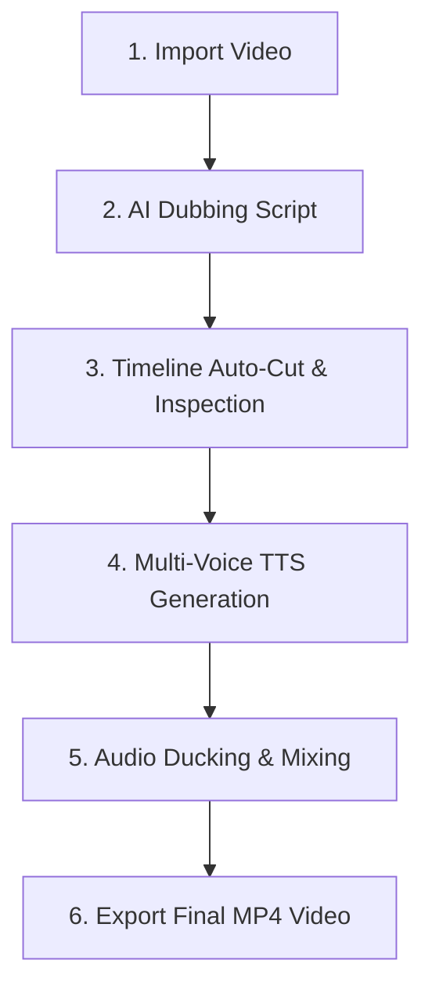

# Khmer AI Dubbing Studio (CapCut Pro Edition) 🎬🇰🇭

> **All-in-One Professional AI Video Dubbing & Storytelling Studio** for Content Creators, Facebook Reels, TikTok, and YouTube creators in Cambodia.

Khmer AI Dubbing Studio គឺជាកម្មវិធី All-in-One Web Studio បែប **CapCut Desktop Workspace** សម្រាប់ផលិតវីដេអូសម្រាយរឿងភាគចិន សម្រាយរឿងកុន និង Dubbing សំឡេងខ្មែរដោយស្វ័យប្រវត្តិតាមរយៈ **Google Gemini 3.8 Flash**, **Microsoft Edge Neural TTS (ពិសិដ្ឋ & ស្រីមុំ)** និង **Google TTS** ភ្ជាប់ជាមួយ **FFmpeg Audio Ducking & Vocal Replacement Engine**។

---

## 🌟 លក្ខណៈពិសេសចម្បង (Key Features)

### 1. 🎬 CapCut-Style Desktop Workspace (3-Column Layout & Multi-Track Timeline)
- **3-Column Professional Suite:**
  - **Left Panel (Media & Script Library):**
    - **Tab 1 (Media):** កន្លែង Import Video, ពិនិត្យមើល FFprobe Metadata (Resolution, FPS, Duration, Codec), និងប៊ូតុង Load Sample Video។
    - **Tab 2 (AI Dubbing):** បង្កើត Script តាម **Mode A (Faithful Dialogue Dubbing)** ឬ **Mode B (Cinematic Drama Recap)** ជាមួយ Prompt Presets សម្រាប់ TikTok & YouTube។
    - **Tab 3 (Script & Subs):** កែសម្រួលអត្ថបទសន្ទនា Timestamp ស្វែងរកពាក្យ (Search) និងមើលបញ្ជីតួអង្គ។
  - **Center Panel (Player Monitor):**
    - Preview វីដេអូកម្រិតច្បាស់ផ្ទាល់ក្នុង Browser។
    - ប្តូរ Aspect Ratio ភ្លាមៗ (`16:9` YouTube, `9:16` TikTok/Reels, `1:1` Square, ឬ `Fit`)។
    - បង្ហាញ Live Subtitle Overlay ត្រូវនឹង Timestamp និង Audio Ducking indicator។
  - **Right Panel (Audio, Inspector & Export):**
    - **Selected Dialogue Clip Inspector:** ចុចលើ Clip ណាមួយលើ Timeline នឹងបង្ហាញអត្ថបទសន្ទនា ឈ្មោះតួ និងប៊ូតុងដូរសំឡេង ១ Click (`👩 ស្រីមុំ` / `👨 ពិសិដ្ឋ`) ព្រមទាំង Auto-regenerate សំឡេងឡើងវិញភ្លាមៗ។
    - **Character Voices (សំឡេងតាមតួអង្គ):** បង្ហាញបញ្ជីតួអង្គទាំងអស់ ភេទ (ស្រី/ប្រុស) ចំនួនឃ្លា និងសំឡេងដែលបានកំណត់។
    - **Audio Ducking Sliders:** កម្រិតសំឡេងដើម (Background Video Volume) និងសំឡេងខ្មែរ AI (Khmer Voice Volume)។
    - **Sound Modes:** `Smart Ducking (85%)` ឬ `Replace Vocal (100% Mute)`។
    - **Subtitle Customization:** ជ្រើសរើសពណ៌អក្សរ ទំហំអក្សរ និងបិទ/បើក Burn Subtitles។
    - **Export Video CTA:** Render វីដេអូជា `.mp4` ជាមួយ FFmpeg។

### 2. 🎛️ Bottom Multi-Track Timeline (CapCut Timeline Engine)
- **ឧបករណ៍កាត់តលើ Toolbar:**
  - `✂️ Split Clip (Ctrl+B)`: កាត់វីដេអូត្រង់ចំណុច Playhead ភ្លាមៗ។
  - `🎬 Auto-Cut by Subs (CapCut)`: កាត់ Video Track ជាកង់ៗស្វ័យប្រវត្តិតាមឃ្លាសន្ទនានីមួយៗ `#1, #2, #3...` ដូច CapCut។
  - `🔗 Bridge Gaps`: តភ្ជាប់ឃ្លាសន្ទនាបិទចន្លោះទទេស្ងាត់ៗ (Remove dead silence)។
  - `🗑️ Delete Clip (Del)`: លុប Clip ដែលបាន Select។
  - Timecode Display (`00:00.00 / 00:31.65`) និង Zoom Slider (`0.5x` ដល់ `3.0x`)។
- **Tracks លើ Timeline:**
  - **Track 1 (`VIDEO 1`):** Video clips អាច Drag រំកិល និង Trim ក្បាលកន្ទុយបាន មាន styling បែប `.dialogue-slice` និង `.gap-slice`។
  - **Track 2 (`KHMER VOICE 1`):** Audio Dubbing Clips បង្ហាញ Avatar (`👩` ផ្កាឈូកសម្រាប់តួស្រី, `👨` ខៀវសម្រាប់តួប្រុស) ឈ្មោះតួអង្គ និងរយៈពេល។
  - **Track 3 (`SUBTITLES`):** Subtitle caption blocks ពណ៌ស្វាយ អាច Drag និង Trim បានដូចគ្នា។
- **Red Playhead Scrubber:** បន្ទាត់ក្រហមរត់តាមវិនាទីពិត និងអាច Drag Scrubbing ទៅមកបានរលូន។

### 3. 🎙️ Multi-Voice AI Dubbing (Edge TTS Neural & Google TTS)
- **Microsoft Edge Neural Voices (គុណភាពស្មើ Studio):**
  - `km-KH-PisethNeural`: សំឡេងបុរសខ្មែរ (ពិសិដ្ឋ) ម៉ឺងម៉ាត់ ច្បាស់ និងរស់រវើក។
  - `km-KH-SreymomNeural`: សំឡេងស្ត្រីខ្មែរ (ស្រីមុំ) ស្រទន់ ពិរោះ និងបែបកុនភាគ។
- **Google Translate TTS Khmer (`km`):** សំឡេងស្ត្រីស្តង់ដារ សម្រាប់ fallback។
- **Automatic Speaker-to-Voice Mapping:**
  - ស្គាល់ភេទតួអង្គស្វ័យប្រវត្តិតាមរយៈ Chinese, Khmer (`នារី`, `បុរស`, `ស្ត្រី`, `តួឯកស្រី`, `លោកប្រធាន`...) និង English cues។
  - Auto-assign: តួស្រី ➜ `ស្រីមុំ`, តួប្រុស ➜ `ពិសិដ្ឋ`។
  - Auto-Regen ក្នុងពេល `~300ms` ពេលអ្នកប្រើប្រាស់ផ្លាស់ប្តូរសំឡេងឃ្លាណាមួយ។

### 4. 🤖 Gemini 3.8 Flash Multimodal Storytelling
- វិភាគវីដេអូ និងសំឡេងដើម (Multimodal Video & Audio Analysis)។
- គាំទ្រវីដេអូរឿងភាគវែង តាមរយៈ **GoogleAIFileManager**។
- **Cinema-Grade Phrasing:** ប្រើប្រាស់ភាសានិយាយកុនភាគរស់រវើក ជៀសវាងការបកប្រែត្រង់ៗបែប Google Translate និងបន្ថែមពាក្យគួរសមតាមតួអង្គ (លោកប្រធាន, អ្នកស្រី, ម្ចាស់បង, ទូលបង្គំ, បង, អូន...)។
- **Pacing Control:** កំណត់ល្បឿននិយាយ (~3-4 ពាក្យក្នុងមួយវិនាទី) ឱ្យត្រូវនឹង Timestamp របស់ឈុតឆាក។

### 5. ⚡ 100% Real Data & Bundled FFmpeg
- ដំណើរការជាមួយ **Real Data សុទ្ធ ១០០%** គ្មាន fake/mock audio ឡើយ។
- ភ្ជាប់មកជាមួយ FFmpeg ស្រាប់ (`@ffmpeg-installer/ffmpeg`) មិនបាច់ដំឡើង FFmpeg ក្នុង Windows ដោយខ្លួនឯងឡើយ។
- បង្កប់អក្សរខ្មែរលើវីដេអូ (`Burn Subtitles`) ជាមួយ Font ខ្មែរស្អាត (Kantumruy Pro / Battambang)។

---

## 🏗️ រចនាសម្ព័ន្ធគម្រោង (Project Structure)

```text
khmer-ai-dubbing/
├── backend/
│   ├── models/
│   │   ├── segmentModel.js          # Validation & Schema សម្រាប់ Dialogue & Recap Segments
│   │   └── speakerRegistry.js       # Gender Detection (Khmer/Chinese/EN), Voice Mapping & Registry
│   ├── services/
│   │   ├── ffmpegService.js         # Audio Extraction, Ducking (85% / 100%), & Video Rendering
│   │   ├── geminiService.js         # Gemini 3.8 Flash Multimodal Audio Analysis & Cinema Prompts
│   │   └── ttsService.js            # Edge TTS (Piseth & Sreymom) + Google TTS Fallback & Preview
│   ├── tests/                       # API & Audio Synthesis Unit/E2E Tests
│   ├── uploads/                     # Storage សម្រាប់ Video, Audio (.mp3), និង Rendered Output
│   ├── .env                         # Environment Variables (GEMINI_API_KEY, PORT)
│   ├── package.json                 # Backend Dependencies (Express, Multer, Edge-TTS, FFmpeg)
│   └── server.js                    # Express REST API Server (Port 5000)
├── frontend/
│   ├── src/
│   │   ├── components/
│   │   │   ├── MediaLibrary.jsx     # Left Panel: Video Upload, Mode A/B Prompts, & Subtitle Editor
│   │   │   ├── Navbar.jsx           # Header: Project Chip, Server Status, & API Key Modal
│   │   │   ├── ShortcutsModal.jsx   # Keyboard Shortcuts Guide (Space, Ctrl+B, Del, Arrows)
│   │   │   ├── TimelineEditor.jsx   # Bottom: Multi-Track Timeline, Playhead, Split, Auto-Cut, Bridge
│   │   │   ├── VideoPlayerPreview.jsx # Center: Monitor, Aspect Ratio (16:9, 9:16), Live Subtitles
│   │   │   └── VoiceSettings.jsx    # Right: Selected Clip Inspector, Ducking, Voices, Export
│   │   ├── services/
│   │   │   └── api.js               # Frontend API Client (Upload, Script, TTS, Render, Preview)
│   │   ├── utils/
│   │   │   ├── formatTime.js        # Timecode Formatter (HH:MM:SS.ms, MM:SS) & Parsers
│   │   │   ├── speakerUtils.js      # Client-side Gender Detection & Speaker Registry Sync
│   │   │   └── timelineUtils.js     # Split Clip, Auto-Cut by Subs, & Pixel-per-Second Logic
│   │   ├── App.jsx                  # Main Editor Workspace Controller & Global State Sync
│   │   ├── index.css                # CapCut Pro Dark Desktop Theme & Responsive Styles
│   │   └── main.jsx                 # React App Entrypoint
│   ├── package.json                 # Frontend Dependencies (React, Vite, Lucide-React)
│   └── vite.config.js               # Vite Configuration (Proxy `/api` & `/uploads` to Port 5000)
├── .agents/
│   └── STATE.md                     # Antigravity Sync Memory (Session Context & Active Ports)
├── dev.ps1                          # Automated PowerShell Launcher (Kill Old Ports & Run Both)
├── start.bat                        # Windows Double-Click Launcher
└── README.md                        # Documentation
```

---

## 🚀 របៀបដំឡើង និងដំណើរការ (Quick Start)

### ១. លក្ខខណ្ឌតម្រូវ (Prerequisites)
- **Node.js** (v18+ ឬ v20+)
- **Google Gemini API Key** (ឥតគិតថ្លៃពី [Google AI Studio](https://aistudio.google.com/))

---

### ២. ដំណើរការដោយ 1-Click (ងាយស្រួលបំផុត)

គ្រាន់តែ **Double-Click** លើ file៖
👉 **`start.bat`**

*Script នឹងដំណើរការស្វ័យប្រវត្ត៖*
1. បិទ Port ចាស់ដែលជាន់គ្នា (Ports 5000 & 5173)
2. ចាប់ផ្តើម Backend Server (`http://localhost:5000`)
3. ចាប់ផ្តើម Frontend Studio (`http://localhost:5173`)
4. បើក Browser ចូលកម្មវិធីដោយស្វ័យប្រវត្តិ!

---

### ៣. ដំណើរការតាម PowerShell Script
```powershell
.\dev.ps1
```

---

### ៤. ដំណើរការតាម Terminal ដោយដៃ (Manual Setup)

#### ជំហានទី 1: រៀបចំ Backend
```bash
cd backend
npm install
# បង្កើត file .env
echo GEMINI_API_KEY=your_gemini_api_key_here > .env
node server.js
```
*Backend នឹងដំណើរការលើ `http://localhost:5000`*

#### ជំហានទី 2: រៀបចំ Frontend
```bash
cd frontend
npm install
npm run dev
```
*Frontend Studio នឹងដំណើរការលើ `http://localhost:5173`*

---

## 🛠️ របៀបប្រើប្រាស់ (Step-by-Step Workflow)



1. **Import Video:**
   - ចុចលើ **`Import Drama Video File`** ដើម្បីជ្រើសរើសវីដេអូរឿងភាគចិន ឬចុច **`Load Sample Drama`** ដើម្បីតេស្តជាមួយវីដេអូគំរូ។
2. **Generate Script:**
   - ជ្រើសរើស **`Mode A: Dialogue`** (សម្រាប់រឿងភាគសន្ទនាផ្ទាល់) ឬ **`Mode B: Recap`** (សម្រាប់សម្រាយសាច់រឿងខ្លី TikTok)។
   - ចុច **`✨ បង្កើតសេណារីយ៉ូសន្ទនា (Generate Dialogue)`**។
3. **Timeline Auto-Cut & Edit:**
   - ចុច **`🎬 Auto-Cut by Subs (CapCut)`** ដើម្បីកាត់ Video Track ជាកង់ៗស្វ័យប្រវត្តិតាមឃ្លានីមួយៗ។
   - ចុច **`🔗 Bridge Gaps`** ដើម្បីបិទចន្លោះទទេស្ងាត់ៗរវាងឃ្លា។
   - ដាក់ Playhead ក្រហមត្រង់ចំណុចណា រួចចុច **`✂️ Split Clip`** (ឬ `Ctrl+B`) ដើម្បីកាត់ Clip ដោយដៃ។
4. **Inspect & Switch Character Voice (១ Click):**
   - ចុចលើ Clip ណាមួយលើ Timeline (`KHMER VOICE 1` ឬ `SUBTITLES`)។
   - នៅផ្ទាំងស្តាំដៃ (Inspector) ចុច **`👩 ដូរជា ស្រី (ស្រីមុំ)`** ឬ **`👨 ដូរជា ប្រុស (ពិសិដ្ឋ)`** ➜ ប្រព័ន្ធនឹងបង្កើតសំឡេងឃ្លានោះឡើងវិញភ្លាមៗ (~300ms)។
   - ចុច **`🔊 ស្តាប់ឃ្លានេះ`** ដើម្បីស្តាប់សាកល្បងសំឡេងថ្មី។
5. **Adjust Ducking & Subtitles:**
   - កំណត់កម្រិតសំឡេងដើម (Background Ducking) និងសំឡេងខ្មែរ AI។
   - ជ្រើសរើសពណ៌ និងទំហំ Subtitles។
6. **Export Rendered Video:**
   - ចុចប៊ូតុង **`Export Rendered Video`**។ FFmpeg នឹង Render វីដេអូកម្រិតច្បាស់ រួមបញ្ចូលសំឡេងខ្មែរ AI និង Subtitles រួចរាល់សម្រាប់ Download ជា file `.mp4`!

---

## 📡 API Endpoints Reference

| Method | Endpoint | Description |
|--------|----------|-------------|
| `GET` | `/api/health` | ពិនិត្យមើលស្ថានភាព Server, FFmpeg និង Gemini API Key |
| `GET` | `/api/voices` | ទាញយកបញ្ជីសំឡេង TTS ដែលគាំទ្រ (`Edge Neural` & `Google TTS`) |
| `GET` | `/api/metadata/:videoId` | ទាញយក Video Metadata តាមរយៈ FFprobe (Duration, FPS, Resolution) |
| `POST` | `/api/upload` | Upload វីដេអូចូល Server (Multer Storage) |
| `POST` | `/api/generate-script` | ទាញយកសំឡេង និងបង្កើត Script តាមរយៈ Gemini 3.8 Flash |
| `POST` | `/api/generate-audio` | បង្កើតសំឡេងនិយាយខ្មែរ (គាំទ្រទាំង Single Segment និង Batch Sync) |
| `POST` | `/api/preview-voice` | ស្តាប់សាកល្បងសំឡេង TTS ខ្លីៗ (Edge Neural & Google) |
| `POST` | `/api/render-video` | ប្រើ FFmpeg ដើម្បី Ducking សំឡេង, Replace សំឡេង និង Burn Subtitles |

---

## ⌨️ គ្រាប់ចុចកាត់ (Keyboard Shortcuts)

| Shortcut | Action |
|----------|--------|
| `Space` | Play / Pause វីដេអូ |
| `Ctrl + B` / `⌘ + B` | Split Clip ត្រង់ចំណុច Playhead |
| `Delete` / `Backspace` | លុប Clip ដែលបានជ្រើសរើស |
| `←` / `→` | រំកិល Playhead ថយក្រោយ / ទៅមុខ 1 វិនាទី |

---

## 👨‍💻 អ្នកអភិវឌ្ឍន៍ (Developer)

- **Name:** Nha
- **Institution:** Build Bright University (BBU), Battambang Campus
- **Major:** Information Technology (Year 4, Semester 2)
- **GitHub:** [@Nha0325](https://github.com/Nha0325) / [@Ny-Panha](https://github.com/Ny-Panha)
- **Project:** Khmer AI Dubbing Studio (CapCut Pro Edition)
