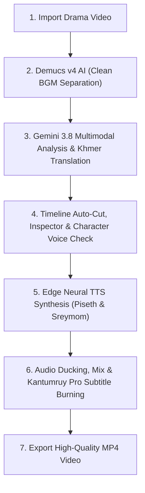

# Khmer AI Dubbing Studio (CapCut Pro Edition) 🎬🇰🇭

> **All-in-One Professional AI Video Dubbing & Drama Storytelling Studio** for Content Creators, Facebook Reels, TikTok, and YouTube creators in Cambodia.

Khmer AI Dubbing Studio គឺជាកម្មវិធី All-in-One Web Studio បែប **CapCut Desktop Workspace** សម្រាប់ផលិតវីដេអូសម្រាយរឿងភាគចិន សម្រាយរឿងកុន និង Dubbing សំឡេងខ្មែរដោយស្វ័យប្រវត្តិតាមរយៈ **Google Gemini 3.8 Flash / Flash-Lite (Multi-Key Pool 75+ RPM)**, **Demucs v4 Neural AI Audio Separation (បំបែក Clean BGM & Vocals)**, **Microsoft Edge Neural TTS (ពិសិដ្ឋ & ស្រីមុំ)** និង **Google TTS** ភ្ជាប់ជាមួយ **FFmpeg Smart Audio Ducking & Vocal Replacement Engine**។

---

## 🌟 លក្ខណៈពិសេសចម្បង (Key Features)

### 1. 🎬 CapCut-Style Desktop Workspace (3-Column Layout & Multi-Track Timeline)
- **3-Column Professional Suite:**
  - **Left Panel (Media & Script Library):**
    - **Tab 1 (Media):** កន្លែង Import Video, ពិនិត្យមើល FFprobe Metadata (Resolution, FPS, Duration, Codec), និងប៊ូតុង Load Sample Video។
    - **Tab 2 (AI Dubbing):** បង្កើត Script តាម **Mode A (Faithful Dialogue Dubbing)** ឬ **Mode B (Cinematic Drama Recap)** ជាមួយ Prompt Presets សម្រាប់ TikTok & YouTube។
    - **Tab 3 (Script & Subs):** កែសម្រួលអត្ថបទសន្ទនា Timestamp ស្វែងរកពាក្យ (Search), ប្រព័ន្ធត្រួតពិនិត្យ Translation Quality Guard និងមើលបញ្ជីតួអង្គ។
  - **Center Panel (Player Monitor):**
    - Preview វីដេអូកម្រិតច្បាស់ផ្ទាល់ក្នុង Browser ជាមួយ precision time tracking។
    - ប្តូរ Aspect Ratio ភ្លាមៗ (`16:9` YouTube, `9:16` TikTok/Reels, `1:1` Square, ឬ `Fit`)។
    - បង្ហាញ Live Subtitle Overlay ត្រូវនឹង Timestamp និង Audio Ducking indicator។
  - **Right Panel (Audio, Inspector & Export):**
    - **Selected Dialogue Clip Inspector:** ចុចលើ Clip ណាមួយលើ Timeline នឹងបង្ហាញអត្ថបទសន្ទនា ឈ្មោះតួ និងប៊ូតុងដូរសំឡេង ១ Click (`👩 ស្រីមុំ` / `👨 ពិសិដ្ឋ`) ព្រមទាំង Auto-regenerate សំឡេងឡើងវិញភ្លាមៗ (~300ms)។
    - **Character Voices (សំឡេងតាមតួអង្គ):** បង្ហាញបញ្ជីតួអង្គទាំងអស់ ភេទ (ស្រី/ប្រុស) ចំនួនឃ្លា និងសំឡេងដែលបានកំណត់។
    - **Audio Ducking Sliders:** កម្រិតសំឡេងដើម (Background Video Volume) និងសំឡេងខ្មែរ AI (Khmer Voice Volume)។
    - **Sound Modes:** `Smart Ducking (85%)` ឬ `Replace Vocal (100% Mute)`។
    - **Subtitle Customization:** ជ្រើសរើស Style (Banner, Pill, Cinema), ពណ៌អក្សរ, ទំហំអក្សរ, ទីតាំង និងបិទ/បើក Burn Subtitles ជាមួយ Font Kantumruy Pro។
    - **Export Video CTA:** Render វីដេអូជា `.mp4` ជាមួយ FFmpeg ដោយផ្ទាល់។

### 2. 🎛️ Bottom Multi-Track Timeline (CapCut Timeline Engine)
- **ឧបករណ៍កាត់តលើ Toolbar:**
  - `✂️ Split Clip (Ctrl+B)`: កាត់វីដេអូត្រង់ចំណុច Playhead ភ្លាមៗ។
  - `🎬 Auto-Cut by Subs (CapCut)`: កាត់ Video Track ជាកង់ៗស្វ័យប្រវត្តិតាមឃ្លាសន្ទនានីមួយៗ `#1, #2, #3...` ដូច CapCut។
  - `🔗 Bridge Gaps`: តភ្ជាប់ឃ្លាសន្ទនាបិទចន្លោះទទេស្ងាត់ៗ (Remove dead silence)។
  - `🗑️ Delete Clip (Del)`: លុប Clip ដែលបាន Select។
  - Timecode Display (`00:00.00 / 00:31.65`) និង Zoom Slider (`0.5x` ដល់ `3.0x`)។
- **Tracks លើ Timeline:**
  - **Track 1 (`VIDEO 1`):** Video clips អាច Drag រំកិល និង Trim ក្បាលកន្ទុយបាន មាន styling បែប `.dialogue-slice` និង `.gap-slice`។
  - **Track 2 (`KHMER VOICE 1`):** Audio Dubbing Clips បង្ហាញ Avatar (`👩` ផ្កាឈូកសម្រាប់តួស្រី, `👨` ខៀវសម្រាប់តួប្រុស) ឈ្មោះតួអង្គ និងរយៈពេល។
  - **Track 3 (`SUBTITLES`):** Subtitle caption blocks ពណ៌ស្វាយ អាច Drag និង Trim បានដូចគ្នា។
- **Red Playhead Scrubber:** បន្ទាត់ក្រហមរត់តាមវិនាទីពិត និងអាច Drag Scrubbing ទៅមកបានរលូន។

### 3. 🧠 Demucs v4 Neural Vocal Separation (រក្សាភ្លេង និង Sound Effects ដើម)
- **Zero Dialogue Bleed:** ប្រើប្រាស់ PyTorch Demucs v4 Neural Network (`htdemucs`) ដើម្បីបំបែកសំឡេងសន្ទនាដើម (Chinese Vocals) ចេញពីភ្លេងកំដររឿង (Clean BGM & SFX)។
- **Studio-Quality Audio Dubbing:** នៅពេលបញ្ចូលសំឡេងខ្មែរ AI ភ្លេងកំដររឿងដើមនៅតែលាន់ឮពិរោះរណ្តំធម្មជាតិ គ្មានសំឡេងចិនដើមលាយឡំឡើយ។
- **Real-Time Live Console Stream:** បង្ហាញ Console Drawer ផ្ទាល់ក្នុង Dashboard ជាមួយភាគរយដំណើរការ (`Demucs Progress: 10%... 50%... 100%`) ដូចគ្នាបេះបិទនឹង Terminal។
- **Concurrency Mutex Protection:** ដំណើរការបំបែកសំឡេងម្តង ១ ភាគ (1-by-1 Sequential Queue) ការពារកុំឱ្យ CPU/RAM ឡើងកម្ដៅ ឬគាំងម៉ាស៊ីន។
- **Resilient Fallback Engine:** ប្រសិនបើតេស្តលើម៉ាស៊ីនដែលគ្មាន Python Demucs ប្រព័ន្ធនឹងប្តូរទៅប្រើ High-Pass / Low-Pass Frequency Filter របស់ FFmpeg ដោយស្វ័យប្រវត្តិ។

### 4. ⚡ Gemini Multi-Key Pool & Quota Manager (High-Throughput 75+ RPM)
- **Multi-Key Load Balancing:** គាំទ្រការដាក់ Gemini API Key ច្រើនក្នុងពេលតែមួយ (ពី `GEMINI_API_KEY1` ដល់ `GEMINI_API_KEY6`)។
- **Smart Rotation & Auto-Recovery:** បង្វិល Key ស្វ័យប្រវត្តិពេលជួបបញ្ហា Rate Limit (`429 Too Many Requests`) ឬ Timeout (`504 Gateway Timeout`) ជាមួយ Exponential Backoff Retry។
- **Live `.env` Hot-Reload:** កែសម្រួល ឬបន្ថែម API Key ក្នុង file `.env` បានភ្លាមៗដោយពុំបាច់ Restart Server។
- **Interactive Quota Modal:** បង្ហាញស្ថានភាពសុខភាព Keys ទាំងអស់, RPM, TPD, Success Rate និង Response Latency ក្នុង Dashboard។

### 5. 🎙️ Multi-Voice AI Dubbing (Edge TTS Neural & Google TTS)
- **Microsoft Edge Neural Voices (គុណភាពស្មើ Studio):**
  - `km-KH-PisethNeural`: សំឡេងបុរសខ្មែរ (ពិសិដ្ឋ) ម៉ឺងម៉ាត់ ច្បាស់ និងរស់រវើក។
  - `km-KH-SreymomNeural`: សំឡេងស្ត្រីខ្មែរ (ស្រីមុំ) ស្រទន់ ពិរោះ និងបែបកុនភាគ។
- **Google Translate TTS Khmer (`km`):** សំឡេងស្ត្រីស្តង់ដារ សម្រាប់ fallback។
- **Automatic Speaker-to-Voice Mapping:**
  - ស្គាល់ភេទតួអង្គស្វ័យប្រវត្តិតាមរយៈ Chinese, Khmer (`នារី`, `បុរស`, `ស្ត្រី`, `តួឯកស្រី`, `លោកប្រធាន`...) និង English cues។
  - Auto-assign: តួស្រី ➜ `ស្រីមុំ`, តួប្រុស ➜ `ពិសិដ្ឋ`។
  - Auto-Regen ក្នុងពេល `~300ms` ពេលអ្នកប្រើប្រាស់ផ្លាស់ប្តូរសំឡេងឃ្លាណាមួយ។

### 6. 📺 Series & Multi-Episode Batch Workflow (Jobs Dashboard)
- **Series Manager:** បង្កើត និងគ្រប់គ្រងរឿងភាគជា Series (Ep 1, Ep 2, Ep 3...) រក្សាទុកទិន្នន័យដាច់ដោយឡែកពីគ្នា។
- **Automated Batch Processing:** រត់ Batch ស្វ័យប្រវត្តិតាមលំដាប់លំដោយ (Extract Audio ➜ Demucs BGM ➜ Gemini Translate ➜ Edge TTS ➜ Render)។
- **Real-Time Jobs Stream (SSE):** តាមដានដំណើរការ Job តាម Server-Sent Events បង្ហាញ Progress Bar, Console Logs និងប៊ូតុង Kill/Cancel Job ភ្លាមៗ។
- **Self-Healing Segment Repair:** សេវាកម្ម `repairBrokenService` ជួសជុលឃ្លាដែលបកប្រែដាច់ ឬមាន Duration មិនស៊ីគ្នាជាមួយឈុតឆាកដោយស្វ័យប្រវត្តិ។

---

## 🏗️ រចនាសម្ព័ន្ធគម្រោង (Project Structure)

```text
khmer-ai-dubbing/
├── backend/
│   ├── models/
│   │   ├── segmentModel.js          # Validation & Schema សម្រាប់ Dialogue & Recap Segments
│   │   └── speakerRegistry.js       # Gender Detection (Khmer/Chinese/EN) & Voice Registry
│   ├── routes/                      # Modular Express REST API Routers
│   │   ├── audioRoutes.js           # TTS, Voice Preview, Demucs Separation & Live Logs
│   │   ├── jobRoutes.js             # Batch Pipeline Execution, SSE Job Stream & Repair
│   │   ├── scriptRoutes.js          # Gemini Multimodal Scripting & Retranslation
│   │   ├── seriesRoutes.js          # Series & Multi-Episode CRUD Management
│   │   ├── systemRoutes.js          # System Health, Gemini Key Pool, Quota & Uploads
│   │   └── videoRoutes.js           # FFprobe Video Metadata, Thumbnails & Video Rendering
│   ├── services/
│   │   ├── pipeline/                # 7-Stage Dubbing Pipeline
│   │   │   ├── chunkOrchestrator.js # Long Video Batching & Chunk Orchestrator
│   │   │   ├── dubbingPipeline.js   # Master Pipeline Runner (Stages 1-7)
│   │   │   └── stages/              # Individual Pipeline Stage Processors
│   │   ├── audioClassifierService.js # Voice / Music / Silence Energy Classifier
│   │   ├── audioSeparationService.js # Demucs v4 Execution & Real-Time Progress Tracker
│   │   ├── batchExportService.js     # Batch Video Rendering & Episode Packager
│   │   ├── episodeService.js        # Multi-Episode File Isolation & State Storage
│   │   ├── ffmpegService.js         # Audio Ducking, Vocal Replacement & Burn Subtitles
│   │   ├── geminiKeyManager.js      # Multi-Key Pool (Up to 6 Keys) & .env Hot-Reload
│   │   ├── geminiQuotaTracker.js    # Real-Time RPM/TPD Quota & Health Diagnostics
│   │   ├── geminiService.js         # Gemini 3.8 Multimodal Analysis & Cinema Prompts
│   │   ├── repairBrokenService.js   # Automated Segment Healing & Syntax Fixes
│   │   ├── ttsService.js            # Edge TTS (Piseth & Sreymom) + Google TTS Fallback
│   │   └── vadAlignmentService.js   # Voice Activity Detection (VAD) & Alignment
│   ├── utils/
│   │   └── translationQuality.js    # Khmer Grammar, Foreign Word & Duration Validator
│   ├── workers/
│   │   └── demucs_worker.py         # PyTorch Demucs v4 Worker for Vocal Separation
│   ├── tests/                       # Unit & Integration Tests (14+ Suites Passing)
│   ├── uploads/                     # Storage សម្រាប់ Video, Audio, Vocals, BGM, & Exports
│   ├── .env                         # Multi-Key Configuration (GEMINI_API_KEY1..6, PORT)
│   ├── package.json                 # Backend Dependencies (Express, Multer, Edge-TTS, FFmpeg)
│   └── server.js                    # Express Server Entrypoint (Port 5000)
├── frontend/
│   ├── src/
│   │   ├── components/
│   │   │   ├── common/              # Reusable UI (StudioConfirmDialog)
│   │   │   ├── dashboard/           # Series, Route Runner, Demucs/TTS Cards & Jobs Modal
│   │   │   │   ├── GeminiQuotaModal.jsx       # Real-Time Multi-Key Health & Quota Dashboard
│   │   │   │   ├── GeminiRouteModal.jsx       # Multi-Episode Pipeline Runner & Console Logs
│   │   │   │   ├── JobDashboardModal.jsx      # Active Jobs Queue & SSE Live Stream Monitor
│   │   │   │   └── route-runners/             # Live Progress Cards (Demucs, Translate, TTS)
│   │   │   ├── media/               # Media Library & File Import Components
│   │   │   ├── player/              # Video Player Monitor & Aspect Ratio Overlays
│   │   │   ├── timeline/            # Multi-Track Waveform Timeline & Cutting Tools
│   │   │   ├── voice/               # Voice Inspector, Character Mapping & Ducking
│   │   │   ├── MediaLibrary.jsx     # Left Panel: Video Upload, Mode A/B & Subtitle Editor
│   │   │   ├── Navbar.jsx           # Header: Key Pool Badge, Quota Modal, & Health Status
│   │   │   ├── ShortcutsModal.jsx   # Keyboard Shortcuts Guide (Space, Ctrl+B, Del, Arrows)
│   │   │   ├── TimelineEditor.jsx   # Multi-Track Timeline Engine & Toolbar Controls
│   │   │   ├── VideoPlayerPreview.jsx # High-Precision Video Player & Subtitle Canvas
│   │   │   └── VoiceSettings.jsx    # Inspector, Ducking, Voice Config & Render CTA
│   │   ├── services/
│   │   │   └── api.js               # Frontend API Client (Upload, Pipeline, TTS, Export)
│   │   ├── utils/
│   │   │   ├── formatTime.js        # Timecode Formatter (HH:MM:SS.ms, MM:SS) & Parsers
│   │   │   ├── speakerUtils.js      # Client-side Gender Detection & Speaker Registry Sync
│   │   │   ├── timelineUtils.js     # Split Clip, Auto-Cut by Subs, & Pixel-per-Second Logic
│   │   │   └── translationQuality.js # Client-side Translation Verification
│   │   ├── App.jsx                  # Main Studio App & Global State Orchestrator
│   │   ├── index.css                # CapCut Pro Dark Desktop Theme & Responsive Styles
│   │   └── main.jsx                 # React Entrypoint
│   ├── package.json                 # Frontend Dependencies (React 18, Vite, Lucide-React)
│   └── vite.config.js               # Vite Configuration (Proxy `/api` & `/uploads` to Port 5000)
├── .agents/
│   └── STATE.md                     # Antigravity CLI / IDE Shared State Protocol
├── dev.ps1                          # PowerShell Orchestrator (Auto-Kill Ports, Pre-flight & Run)
├── start.bat                        # Windows 1-Click Double-Click Launcher
└── README.md                        # Documentation
```

---

## 🚀 របៀបដំឡើង និងដំណើរការ (Quick Start)

### ១. លក្ខខណ្ឌតម្រូវ (Prerequisites)
- **Node.js**: v18+ ឬ v20+
- **Google Gemini API Key(s)**: ឥតគិតថ្លៃពី [Google AI Studio](https://aistudio.google.com/) (អាចដាក់ពី ១ ដល់ ៦ Keys សម្រាប់ដំណើរការលឿន 75+ RPM)
- **Python (ស្រេចចិត្ត / Optional)**: Python 3.10+ ជាមួយ PyTorch & Demucs សម្រាប់មុខងារបំបែក BGM កម្រិតខ្ពស់ (ប្រសិនបើគ្មានទេ ប្រព័ន្ធនឹងប្រើ FFmpeg Vocal Filter ជំនួសដោយស្វ័យប្រវត្តិ)

---

### ២. ដំណើរការដោយ 1-Click (ងាយស្រួលបំផុត)
គ្រាន់តែ **Double-Click** លើ file៖
👉 **`start.bat`**

*Script នឹងដំណើរការស្វ័យប្រវត្ត៖*
1. បិទ Port ចាស់ដែលជាន់គ្នា (Ports 5000 & 5173)
2. ចាប់ផ្តើម Backend Server (`http://localhost:5000`)
3. ចាប់ផ្តើម Frontend Studio (`http://localhost:5173`)
4. បើក Browser ចូលកម្មវិធីដោយស្វ័យប្រវត្តិ!

---

### ៣. ដំណើរការតាម PowerShell Script
```powershell
.\dev.ps1
```
*ជម្រើសបន្ថែម (Options):*
- `.\dev.ps1 -Fast`: រំលង dependency check ដើម្បីបើកដំណើរការលឿន
- `.\dev.ps1 -NewWindow`: បើក Backend និង Frontend ក្នុងផ្ទាំង Terminal ដាច់ដោយឡែក
- `.\dev.ps1 -NoBrowser`: កុំបើក Web Browser ដោយស្វ័យប្រវត្តិ

---

### ៤. ដំណើរការតាម Terminal ដោយដៃ (Manual Setup)

#### ជំហានទី 1: រៀបចំ Backend
```bash
cd backend
npm install
# បង្កើត file .env និងដាក់ Gemini API Keys
echo GEMINI_API_KEY=your_primary_key_here > .env
echo GEMINI_API_KEY2=your_second_key_here >> .env
node server.js
```
*Backend នឹងដំណើរការលើ `http://localhost:5000`*

#### ជំហានទី 2: រៀបចំ Frontend
```bash
cd frontend
npm install
npm run dev
```
*Frontend Studio នឹងដំណើរការលើ `http://localhost:5173`*

---

## 🛠️ របៀបប្រើប្រាស់ (Step-by-Step Workflow)



1. **Import Video:**
   - ចុចលើ **`Import Drama Video File`** ដើម្បីជ្រើសរើសវីដេអូរឿងភាគចិន ឬចុច **`Load Sample Drama`** ដើម្បីតេស្តជាមួយវីដេអូគំរូ។
2. **AI Audio Separation (Clean BGM):**
   - ដំណើរការបំបែកសំឡេងចិនដើមចេញពីភ្លេងកំដររឿង (Clean BGM) តាមរយៈ Demucs v4 ដោយតាមដាន Live Console Log ផ្ទាល់លើ Web UI។
3. **Generate Script & Translate:**
   - ជ្រើសរើស **`Mode A: Dialogue`** (សម្រាប់រឿងភាគសន្ទនាផ្ទាល់) ឬ **`Mode B: Recap`** (សម្រាប់សម្រាយសាច់រឿងខ្លី TikTok)។
   - ចុច **`✨ បង្កើតសេណារីយ៉ូសន្ទនា (Generate Dialogue)`** (ប្រព័ន្ធនឹងបង្វិល Gemini Key Pool ដោយស្វ័យប្រវត្តិ)។
4. **Timeline Auto-Cut & Edit:**
   - ចុច **`🎬 Auto-Cut by Subs (CapCut)`** ដើម្បីកាត់ Video Track ជាកង់ៗស្វ័យប្រវត្តិតាមឃ្លានីមួយៗ។
   - ចុច **`🔗 Bridge Gaps`** ដើម្បីបិទចន្លោះទទេស្ងាត់ៗរវាងឃ្លា។
   - ដាក់ Playhead ក្រហមត្រង់ចំណុចណា រួចចុច **`✂️ Split Clip`** (ឬ `Ctrl+B`) ដើម្បីកាត់ Clip ដោយដៃ។
5. **Inspect & Switch Character Voice (១ Click):**
   - ចុចលើ Clip ណាមួយលើ Timeline (`KHMER VOICE 1` ឬ `SUBTITLES`)។
   - នៅផ្ទាំងស្តាំដៃ (Inspector) ចុច **`👩 ដូរជា ស្រី (ស្រីមុំ)`** ឬ **`👨 ដូរជា ប្រុស (ពិសិដ្ឋ)`** ➜ ប្រព័ន្ធនឹងបង្កើតសំឡេងឃ្លានោះឡើងវិញភ្លាមៗ (~300ms)។
   - ចុច **`🔊 ស្តាប់ឃ្លានេះ`** ដើម្បីស្តាប់សាកល្បងសំឡេងថ្មី។
6. **Adjust Ducking & Subtitles:**
   - កំណត់កម្រិតសំឡេងដើម (Background Ducking) និងសំឡេងខ្មែរ AI។
   - ជ្រើសរើស Mode `Smart Ducking (85%)` ឬ `Replace Vocal (100% Mute)`។
   - ជ្រើសរើសរចនាប័ទ្ម Subtitles (Banner, Pill, Cinema) ពណ៌ និងទំហំអក្សរ។
7. **Export Rendered Video:**
   - ចុចប៊ូតុង **`Export Rendered Video`**។ FFmpeg នឹង Render វីដេអូកម្រិតច្បាស់ រួមបញ្ចូល Clean BGM, សំឡេងខ្មែរ AI និង Subtitles រួចរាល់សម្រាប់ Download ជា file `.mp4`!

---

## 📡 API Endpoints Reference

### ១. ប្រព័ន្ធ និង Gemini Multi-Key Pool (System & Keys)
| Method | Endpoint | Description |
|--------|----------|-------------|
| `GET` | `/api/health` | ពិនិត្យមើលស្ថានភាព Server, FFmpeg និង Key Pool |
| `GET` | `/api/gemini/keys-status` | ពិនិត្យស្ថានភាព Gemini Keys ទាំងអស់ (Health, RPM, Latency) |
| `POST` | `/api/gemini/quota-settings` | កំណត់ Quota Limits និង Switch Model Priority |
| `POST` | `/api/upload` | Upload វីដេអូចូល Server (Multer Storage) |

### ២. សំឡេង និង Demucs Separation (Audio & Separation)
| Method | Endpoint | Description |
|--------|----------|-------------|
| `GET` | `/api/voices` | ទាញយកបញ្ជីសំឡេង TTS ដែលគាំទ្រ (`Edge Neural` & `Google TTS`) |
| `POST` | `/api/preview-voice` | ស្តាប់សាកល្បងសំឡេង TTS ខ្លីៗ (Edge Neural & Google) |
| `POST` | `/api/generate-audio` | បង្កើតសំឡេងនិយាយខ្មែរ (Single Segment ឬ Batch) |
| `POST` | `/api/audio/separate` | ចាប់ផ្តើម Demucs v4 Neural Vocal Separation |
| `GET` | `/api/audio/separation-progress`| តាមដាន Live Separation Progress និង Console Logs |
| `POST` | `/api/audio/separate-kill` | បញ្ឈប់ដំណើរការ Demucs ដែលកំពុងរត់ភ្លាមៗ |
| `POST` | `/api/audio/sync-audio` | ធ្វើសមកាលកម្មសំឡេង និងល្បឿននិយាយ (Speed Pacing) |

### ៣. សេណារីយ៉ូ និងការបកប្រែ (Script & Translation)
| Method | Endpoint | Description |
|--------|----------|-------------|
| `POST` | `/api/generate-script` | វិភាគវីដេអូ និងបង្កើត Script តាមរយៈ Gemini 3.8 Flash |
| `POST` | `/api/dubbing/retranslate-segment` | បកប្រែឃ្លាណាមួយឡើងវិញ (Re-translate Single Segment) |
| `POST` | `/api/dubbing/retranslate-all` | បកប្រែសាច់រឿងទាំងមូលឡើងវិញទាំងអស់ |
| `POST` | `/api/dubbing/import-subtitles` | Import File Subtitles (`.srt`, `.vtt`, `.json`) ពីក្រៅ |

### ៤. រឿងភាគ និង Jobs Queue (Series & Batch Jobs)
| Method | Endpoint | Description |
|--------|----------|-------------|
| `GET` | `/api/series` | ទាញយកបញ្ជី Drama Series ទាំងអស់ |
| `POST` | `/api/series` | បង្កើត Drama Series ថ្មី |
| `POST` | `/api/series/:seriesId/episodes` | បន្ថែមភាគថ្មី (Episode) ចូលក្នុង Series |
| `DELETE`| `/api/series/:seriesId/episodes/:episodeId` | លុប Episode ចេញពី Series |
| `POST` | `/api/jobs/generate` | ចាប់ផ្តើម Batch Dubbing Pipeline សម្រាប់ Episode |
| `GET` | `/api/jobs/stream` | Server-Sent Events (SSE) សម្រាប់ Live Job Status & Logs |
| `POST` | `/api/jobs/repair-broken` | ជួសជុលឃ្លាដែលបកប្រែដាច់ ឬមាន Duration មិនប្រក្រតី |

### ៥. វីដេអូ និង Export Render (Video & Rendering)
| Method | Endpoint | Description |
|--------|----------|-------------|
| `POST` | `/api/video-metadata` | ទាញយក Video Metadata តាមរយៈ FFprobe (Duration, FPS, Codec) |
| `POST` | `/api/video-thumbnails` | បង្កើត Filmstrip Thumbnails សម្រាប់ Timeline Track |
| `POST` | `/api/render-video` | ប្រើ FFmpeg ដើម្បី Ducking សំឡេង, Replace សំឡេង និង Burn Subtitles |
| `GET` | `/api/download-export` | Download វីដេអូស្រេចបាច់ជា file `.mp4` |

---

## ⌨️ គ្រាប់ចុចកាត់ (Keyboard Shortcuts)

| Shortcut | Action |
|----------|--------|
| `Space` | Play / Pause វីដេអូ |
| `Ctrl + B` / `⌘ + B` | Split Clip ត្រង់ចំណុច Playhead |
| `Delete` / `Backspace` | លុប Clip ដែលបានជ្រើសរើស |
| `←` / `→` | រំកិល Playhead ថយក្រោយ / ទៅមុខ 1 វិនាទី |
| `Shift + ←` / `Shift + →` | រំកិល Playhead ថយក្រោយ / ទៅមុខ 5 វិនាទី |

---

## 👨‍💻 អ្នកអភិវឌ្ឍន៍ (Developer)

- **Name:** Nha
- **Institution:** Build Bright University (BBU), Battambang Campus
- **Major:** Information Technology (Year 4, Semester 2)
- **GitHub:** [@Nha0325](https://github.com/Nha0325) / [@Ny-Panha](https://github.com/Ny-Panha)
- **Project:** Khmer AI Dubbing Studio (CapCut Pro Edition)
